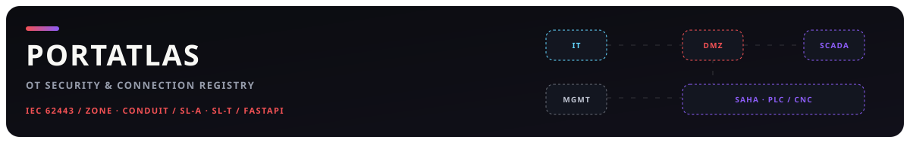
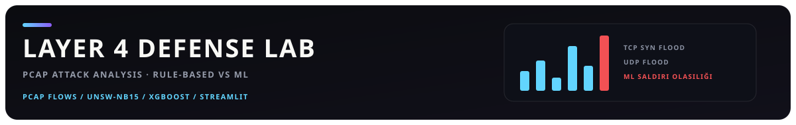
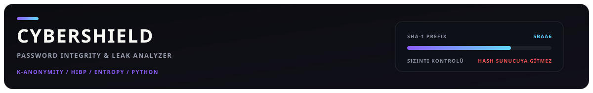
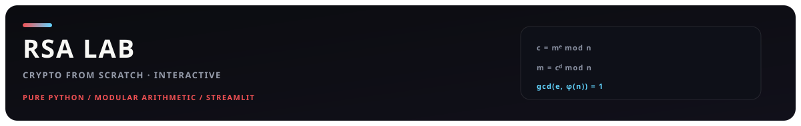

 

  

Siber güvenlik ve OT güvenliği üzerine çalışıyor, öğreniyor ve küçük projeler geliştiriyorum. 
Özellikle endüstriyel ağlar, segmentasyon ve ağ trafiği analizi ilgimi çekiyor.

## PROJECTS

  
  

PortAtlas şu an özel bir repo. Güvenlik dışında birkaç makine öğrenmesi çalışmam da var: [AIHR](https://github.com/eneskavakk/AIHR), [Heart-Attack-Prob](https://github.com/eneskavakk/Heart-Attack-Prob).

## TOOLKIT

